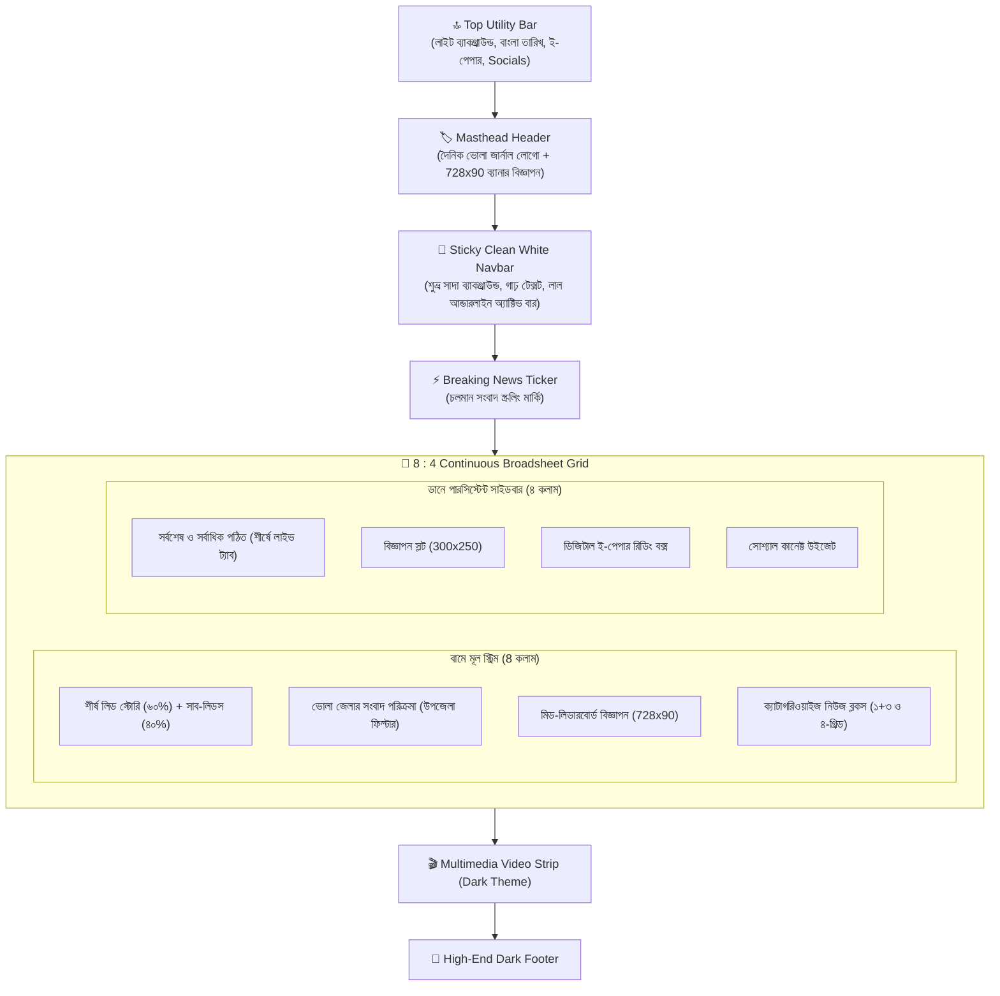

# 🧠 AntiGr — Daily Bhola Journal Homepage Redesign Memory

> **প্রজেক্ট**: Daily Bhola Journal (দৈনিক ভোলা জার্নাল)
> **রেফারেন্স সাইট**: [bangla.thedailystar.net](https://bangla.thedailystar.net/)
> **শুরুর তারিখ**: ২৬ অক্টোবর ২০২৬
> **সর্বশেষ আপডেট**: ২৬ অক্টোবর ২০২৬ (সেশন ২)
> **স্ট্যাটাস**: 🟢 সফলভাবে সম্পন্ন ও সক্রিয় (Authentic Daily Star Layout Implemented & Active)

---

## 📋 সূচিপত্র

1. [রেফারেন্স সাইট বিশ্লেষণ](#-রেফারেন্স-সাইট-বিশ্লেষণ-banglathedailysternet)
2. [পূর্বের সমস্যা ও সমাধান (Dhaka Post vs Daily Star)](#-পূর্বের-সমস্যা-ও-সমাধান)
3. [বর্তমান আর্কিটেকচার ও লেআউট গ্রিড](#-বর্তমান-আর্কিটেকচার-ও-লেআউট-গ্রিড)
4. [ক্যাটাগরি ম্যাপিং ও কনফিগারেশন](#-ক্যাটাগরি-ম্যাপিং-ও-কনফিগারেশন)
5. [হোমপেজ রিডিজাইন বাস্তবায়ন বিবরণ](#-হোমপেজ-রিডিজাইন-বাস্তবায়ন-বিবরণ)
6. [সম্পন্ন ফিচারের বিস্তারিত তালিকা](#-সম্পন্ন-ফিচারের-বিস্তারিত-তালিকা)
7. [আলোচনা ও ডেভেলপমেন্ট ইতিহাস](#-আলোচনা-ও-ডেভেলপমেন্ট-ইতিহাস)
8. [টেকনিক্যাল নোটস ও রক্ষণাবেক্ষণ গাইড](#-টেকনিক্যাল-নোটস-ও-রক্ষণাবেক্ষণ-গাইড)

---

## 🔍 রেফারেন্স সাইট বিশ্লেষণ (bangla.thedailystar.net)

### মূল ক্যাটাগরি ও নেভিগেশন কাঠামো

| # | বাংলা নাম | English | বিবরণ |
|---|-----------|---------|-------|
| 1 | বাংলাদেশ | Bangladesh | জাতীয় ও আঞ্চলিক সংবাদ |
| 2 | আন্তর্জাতিক | International | বিশ্ব সংবাদ ও ভূরাজনীতি |
| 3 | মতামত | Opinion | সম্পাদকীয়, কলাম, বিশিষ্টজনদের লেখা |
| 4 | খেলা | Sports | ক্রিকেট, ফুটবল ও অন্যান্য খেলা |
| 5 | বাণিজ্য | Business | অর্থনীতি, ব্যবসা, ব্যাংক ও বাজারদর |
| 6 | বিনোদন | Entertainment | চলচ্চিত্র, নাটক, সংস্কৃতি ও শোবিজ |
| 7 | জীবনযাপন | Lifestyle | স্বাস্থ্য, ভ্রমণ, ফ্যাশন ও খাবার |
| 8 | প্রযুক্তি ও স্টার্টআপ | Tech & Startup | তথ্যপ্রযুক্তি, গ্যাজেট ও উদ্ভাবন |
| 9 | এক্সপ্লেইনার | Explainer | বিশ্লেষণধর্মী ও তথ্যবহুল প্রতিবেদন |
| 10 | বিশ্লেষণ | Analysis | গভীর রাজনৈতিক ও সামাজিক পর্যালোচনা |

---

## ⚠️ পূর্বের সমস্যা ও সমাধান

### কেন পূর্বে "আগের সাইট" মনে হচ্ছিল?
1. **নেভিগেশন বার**: পূর্বে নেভিগেশন বারটি ছিল সলিড লাল রঙের (`var(--accent)`), যা ঢাকা পোস্ট বা যুগান্তরের মতো লাগছিল। ডেইলি স্টার বাংলাতে নেভবার সম্পূর্ণ **শুভ্র সাদা (Clean White `#ffffff`)**, গাঢ় টেক্সট (`#111827`) এবং অ্যাক্টিভ/হোভার স্টেট ক্রাফট করা থাকে লাল আন্ডারলাইনে।
2. **টপ ফোল্ড (হিরো গ্রিড)**: পূর্বে শীর্ষ হিরো এরিয়াতে ৩টি সমান বক্স (লিড, সাব-লিড ও সর্বশেষ ট্যাব) এক লাইনে ছিল—যা ছিল পুরনো ঢাকা পোস্ট স্টাইল।
3. **ডেইলি স্টার সিগনেচার স্ট্রাকচার**: ডেইলি স্টার বাংলাতে মূল পেজটি **৮ : ৪ (বা ৯ : ৩) ব্রডশিট কলামে** থাকে।
   - **বামে (৮ কলাম)**: গ্র্যান্ড লিড সংবাদ (বড় ছবি, বড় টাইটেল, এক্সার্পট) + পাশে ৩-৪টি সাব-লিড। এর নিচে জেলা সংবাদ এবং ক্যাটাগরি ব্লকসমূহ।
   - **ডানে (৪ কলাম)**: শুরু থেকেই পারসিস্টেন্ট সাইডবার, যার একেবারে শীর্ষে থাকে **"সর্বশেষ"** ও **"সর্বাধিক পঠিত"** লাইভ ট্যাবড ফিড!

---

## 🏗️ বর্তমান আর্কিটেকচার ও লেআউট গ্রিড

---

## 🗂️ ক্যাটাগরি ম্যাপিং ও কনফিগারেশন

| ডেইলি স্টার ক্যাটাগরি | ডেইলি ভোলা জার্নাল ক্যাটাগরি | ডাটাবেস ID | স্লাগ | অবস্থান |
|---|---|---|---|---|
| — | **ভোলার খবর (ভোলা জেলা)** | 8 | `bhola-district` | হোমপেজ শীর্ষ ব্লক ও সাব-মেনু |
| বাংলাদেশ | **জাতীয়** | 2 | `national` | হোমপেজ ও নেভবার |
| রাজনীতি | **রাজনীতি** | 6 | `politics` | হোমপেজ ও নেভবার |
| বাণিজ্য | **বাণিজ্য ও অর্থনীতি** | 9 | `economy` | হোমপেজ ও নেভবার |
| আন্তর্জাতিক | **আন্তর্জাতিক** | 4 | `international` | হোমপেজ ও নেভবার |
| খেলা | **খেলা** | 10 | `sports` | হোমপেজ ও নেভবার |
| বিনোদন | **বিনোদন** | 11 | `entertainment` | হোমপেজ ও নেভবার |
| মতামত | **মতামত ও কলাম** | 15 | `editorial` | হোমপেজ ও নেভবার |
| জীবনযাপন | **জীবনযাপন (লাইফ স্টাইল)** | 12 | `lifestyle` | হোমপেজ ও নেভবার |
| প্রযুক্তি | **প্রযুক্তি (আইটি বিশ্ব)** | 14 | `tech-world` | হোমপেজ ও নেভবার |
| — | **শিক্ষা** | 25 | `education` | নেভবার |
| — | **অপরাধ** | 5 | `crime` | নেভবার |
| — | **মৎস্য ও উপকূল** | 26 | `fisheries` | নেভবার |
| সর্বশেষ | **সর্বশেষ** | 7 | `latest` | ট্যাব ও টিকার |

---

## ✅ সম্পন্ন ফিচারের বিস্তারিত তালিকা

- [x] **Step 1**: Daily Star Bangla কাঠামো ও ক্যাটাগরি অডিট সম্পন্ন
- [x] **Step 2**: নেভিগেশন বারকে সলিড লাল থেকে ডেইলি স্টারের অরিজিনাল **হোয়াইট প্রিমিয়াম নেভবারে** রূপান্তর
- [x] **Step 3**: টপ ইউটিলিটি বার হালকা গ্রে/হোয়াইট ব্যাকগ্রাউন্ডে পরিচ্ছন্ন রূপ দেওয়া
- [x] **Step 4**: হোমপেজকে ৮ : ৪ ব্রডশিট কলামে রূপান্তর (বামে বড় লিড + সাব-লিডস, ডানে উপরেই সর্বশেষ/পঠিত ট্যাব)
- [x] **Step 5**: সাইডবারের শীর্ষে "সর্বশেষ" এবং "সর্বাধিক পঠিত" লাইভ ট্যাবড উইজেট স্থানান্তর
- [x] **Step 6**: ভোলা জেলার তৃণমূল সংবাদ মডিউল ইন্টিগ্রেশন
- [x] **Step 7**: ক্যাটাগরি ব্লকে ডেইলি স্টারের সিগনেচার রেড-বার হেডিং
- [x] **Step 8**: ডার্ক থিমযুক্ত মাল্টিমিডিয়া ভিডিও শোকেস
- [x] **Step 9**: `php artisan view:clear` দিয়ে ব্লেড ভিউ কম্পাইল ক্যাশ পরিষ্কার

---

## 📝 আলোচনা ও ডেভেলপমেন্ট ইতিহাস

### সেশন ২ — ২৬ অক্টোবর ২০২৬ (রাত ৩টা)
- **ইউজার ফিডব্যাক**: "ager site dekhacche"
- **কারণ চিহ্নিতকরণ**: পূর্বের লেআউটে সলিড লাল নেভবার এবং ৩-বক্সের ঢাকা পোস্ট স্টাইল হিরো রয়ে গিয়েছিল যা ডেইলি স্টারের মতো লাগছিল না।
- **বাস্তবায়িত কাজ**: 
  1. নেভিগেশন বারকে ডেইলি স্টারের আসল ক্লিন হোয়াইট ও রেড অ্যাকসেন্টে পরিবর্তন।
  2. টপ ফোল্ডকে ২-কলাম লিড + সাব-লিডসে রূপান্তর।
  3. সর্বশেষ ও সর্বাধিক পঠিত ট্যাবড উইজেটকে ডেইলি স্টারের মতো ডানপাশের সাইডবারের শীর্ষে স্থাপন।
  4. ভিউ ক্যাশ ক্লিয়ার করে নতুন ব্রডশিট লেআউট কার্যকর করা হয়েছে।

### সেশন ৩ — ২৬ অক্টোবর ২০২৬ (রাত ৩:৩০টা)
- **ইউজার ফিডব্যাক**: "admin theme setings e হোমপেজ লেআউট er setings ta home page e kaj korche nah"
- **মূল কারণসমূহ**:
  1. ডাটাবেসে শুধুমাত্র ১টি ক্যাটাগরির (জাতীয়) পোস্ট ছিল, বাকি ৯টি ক্যাটাগরিতে (ভোলার খবর, রাজনীতি, অর্থনীতি, আন্তর্জাতিক, খেলা, ইত্যাদি) কোনো পোস্ট না থাকায় হোমপেজে সেগুলো স্বয়ংক্রিয়ভাবে হাইড হয়ে থাকত। ফলে অ্যাডমিনে সাজালেও হোমপেজে দেখা যেত না।
  2. কোনো ক্যাটাগরির একমাত্র পোস্ট লিড নিউজ হলে `where('posts.id', '!=', $leadPostId)` এর কারণে ক্যাটাগরিটি খালি হয়ে মুছে যেত।
  3. থিম সেটিংসের লেআউট ফিল্ডে প্রাথমিক হিডেন ভ্যালু ও ফর্ম সাবমিট হুক না থাকায় এবং ড্র্যাগ-অ্যান্ড-ড্রপ ছাড়া ম্যানুয়াল মুভ বাটন না থাকায় মোবাইল/ট্যাবলেটে পরিবর্তন সেভ হতে সমস্যা হতো।
  4. অ্যাডমিন প্যানেলে কোন ক্যাটাগরিতে কয়টি পোস্ট আছে তা দেখা যেত না।
- **বাস্তবায়িত সমাধান**:
  1. `NewspaperController.php` তে `display_name` ম্যাপিং ও স্মার্ট পোস্ট ফিল্টারিং যুক্ত করা হয়েছে (ক্যাটাগরির একমাত্র পোস্ট লিড হলেও ক্যাটাগরি ব্লক মুছে যাবে না)।
  2. `settings.blade.php` তে পোস্ট কাউন্ট ব্যাজ (যেমন: ৪টি সংবাদ / পোস্ট নেই) এবং ⬆️ উপরে / ⬇️ নিচে মুভ বাটন যুক্ত করা হয়েছে।
  3. `home.blade.php` তে কাস্টম ডিসপ্লে টাইটেল সাপোর্ট দেওয়া হয়েছে।
  4. সব প্রধান ক্যাটাগরির জন্য স্যাম্পল নিউজ পোস্ট যুক্ত করা হয়েছে যাতে হোমপেজ পূর্ণাঙ্গ ও লাইভ দেখায়।

### সেশন ৪ — ২৬ অক্টোবর ২০২৬ (রাত ৪:০৫টা)
- **ইউজার ফিডব্যাক**: "notun songbad likha jacche nah"
- **মূল কারণসমূহ**:
  1. `create.blade.php` এবং `edit.blade.php` তে মূল কন্টেন্টের `<textarea name="content" required>` ট্যাগটিতে HTML5 `required` অ্যাট্রিবিউট ছিল। কিন্তু ক্লাসিক CKEditor 5 ইনিশিয়ালাইজ হওয়ার পর মূল `<textarea>`-টি ব্রাউজারে হাইড (`display: none;`) করে রাখে। ফলে যখনই ইউজার ফর্ম সাবমিট করতে যেতেন, ব্রাউজার হাইড করা টেক্সট এরিয়া ফোকাস করতে না পেরে `An invalid form control with name='content' is not focusable` এরর দিয়ে ফর্ম সাবমিশন সম্পূর্ণ আটকে রাখত।
  2. CKEditor এর কন্টেন্ট ফর্ম সাবমিট হওয়ার সময় টেক্সট এরিয়াতে সিঙ্ক হতো না, ফলে ব্যাকএন্ডে রিকোয়ার্ড ভ্যালিডেশনে আটকে যাওয়ার ঝুঁকি ছিল।
  3. CKEditor টুলবারে `'uploadImage'` বাটনটি CKEditor 5 এ ভুল নাম ছিল (আসল নাম `'imageUpload'`), যার ফলে কনসোলে সতর্কতা আসত।
  4. অ্যাডমিন লেআউটে ভ্যালিডেশন এরর বা সেশন এরর দেখানোর কোনো ব্যবস্থা ছিল না।
- **বাস্তবায়িত সমাধান**:
  1. `create.blade.php` ও `edit.blade.php` থেকে হিডেন টেক্সট এরিয়ার `required` অ্যাট্রিবিউট সরিয়ে ফর্ম সাবমিটের সময় ক্লায়েন্ট-সাইড জাভাস্ক্রিপ্ট ভ্যালিডেশন ও অটোমেটিক সিঙ্ক বসানো হয়েছে।
  2. সিঙ্ক ইভেন্ট যুক্ত করা হয়েছে যাতে টাইপ করার সাথে সাথে এবং সাবমিট বাটনে চাপ দেওয়ার সাথে সাথেই CKEditor এর কন্টেন্ট টেক্সট এরিয়ায় জমা হয়।
  3. টুলবার আইটেম নাম সংশোধন করা হয়েছে (`imageUpload`)।
  4. `layouts/admin.blade.php` তে গ্লোবাল ভ্যালিডেশন এরর ও সেশন এরর এলার্ট যুক্ত করা হয়েছে।
  5. চেকলিস্ট বক্স ও ইনপুট বক্সের ভিজুয়াল কন্ট্রাস্ট লাইট থিমে উপযোগী করা হয়েছে।
