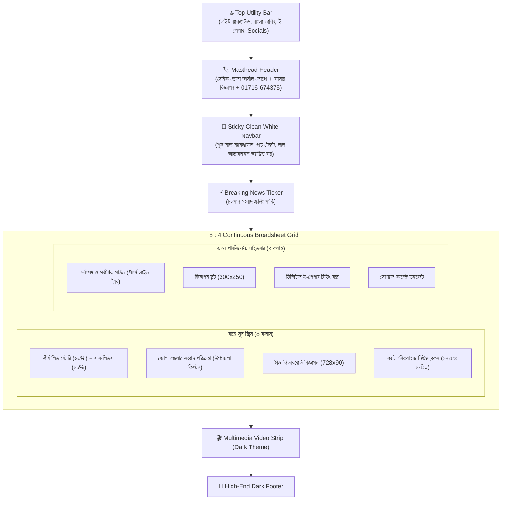

# 🧠 AntiGr — Daily Bhola Journal Homepage Redesign Memory

> **প্রজেক্ট**: Daily Bhola Journal (দৈনিক ভোলা জার্নাল)
> **রেফারেন্স সাইট**: [bangla.thedailystar.net](https://bangla.thedailystar.net/)
> **GitHub রিপোজিটরি**: [SRahul353/dailybholajournal](https://github.com/SRahul353/dailybholajournal)
> **শুরুর তারিখ**: ২৬ অক্টোবর ২০২৬
> **সর্বশেষ আপডেট**: ২৭ অক্টোবর ২০২৬ (রাত ১:১৬)
> **স্ট্যাটাস**: 🟢 সফলভাবে সম্পন্ন, ক্লিনড ও পুশড (Cleaned & Pushed to GitHub)

---

## 📋 সূচিপত্র

1. [GitHub রিপোজিটরি ও ব্রাঞ্চ](#-github-রিপোজিটরি-ও-ব্রাঞ্চ)
2. [তথ্য পরিচ্ছন্নতা ও ফোন নম্বর আপডেট](#-তথ্য-পরিচ্ছন্নতা-ও-ফোন-নম্বর-আপডেট)
3. [রেফারেন্স সাইট বিশ্লেষণ ও ডিজাইন ফ্রেমওয়ার্ক](#-রেফারেন্স-সাইট-বিশ্লেষণ-ও-ডিজাইন-ফ্রেমওয়ার্ক)
4. [বর্তমান আর্কিটেকচার ও লেআউট গ্রিড](#-বর্তমান-আর্কিটেকচার-ও-লেআউট-গ্রিড)
5. [ক্যাটাগরি ম্যাপিং ও কনফিগারেশন](#-ক্যাটাগরি-ম্যাপিং-ও-কনফিগারেশন)
6. [হোমপেজ রিডিজাইন বাস্তবায়ন বিবরণ](#-হোমপেজ-রিডিজাইন-বাস্তবায়ন-বিবরণ)
7. [সম্পন্ন ফিচারের বিস্তারিত তালিকা](#-সম্পন্ন-ফিচারের-বিস্তারিত-তালিকা)
8. [আলোচনা ও ডেভেলপমেন্ট ইতিহাস](#-আলোচনা-ও-ডেভেলপমেন্ট-ইতিহাস)
9. [টেকনিক্যাল নোটস ও রক্ষণাবেক্ষণ গাইড](#-টেকনিক্যাল-নোটস-ও-রক্ষণাবেক্ষণ-গাইড)

---

## 🔗 GitHub রিপোজিটরি ও ব্রাঞ্চ

- **রিপোজিটরি লিঙ্ক**: [https://github.com/SRahul353/dailybholajournal](https://github.com/SRahul353/dailybholajournal)
- **অ্যাকাউন্ট**: `SRahul353`
- **ব্রাঞ্চ**: `master`
- **রিমোট**: `origin` -> `https://github.com/SRahul353/dailybholajournal.git`

---

## 📞 তথ্য পরিচ্ছন্নতা ও ফোন নম্বর আপডেট

- **নতুন মোবাইল নম্বর**: `01716-674375` (হেডার, ফুটার, থিম সেটিংস, ই-পেপার এবং সোশ্যাল কার্ডে আপডেট করা হয়েছে)।
- **পুরনো সাইটের তথ্য অপসারণ**: সমস্ত ফাইল থেকে `bholatimes`, `bholatimes24`, `bhola times`, `ভোলা টাইমস্` ইত্যাদি শব্দ পুরোপুরি সরিয়ে `dailybholajournal` এবং `ভোলা জার্নাল`-এ রূপান্তর করা হয়েছে।
- **ফাইলসমূহের তালিকা**:
  1. `storage/app/theme_settings.json`
  2. `app/Http/Controllers/Admin/AdminThemeSettingsController.php`
  3. `resources/views/layouts/app.blade.php`
  4. `resources/views/layouts/partials/header.blade.php`
  5. `resources/views/layouts/partials/footer.blade.php`
  6. `resources/views/epaper/show.blade.php`
  7. `resources/views/admin/epaper/index.blade.php`
  8. `resources/views/admin/theme/settings.blade.php`
  9. `resources/views/admin/dashboard.blade.php`
  10. `resources/views/admin/posts/social_card.blade.php`
  11. `app/Models/Post.php`
  12. `app/Http/Controllers/Admin/AdminEPaperController.php`
  13. `config/database.php`
  14. `database/seeders/AdminUserSeeder.php`
  15. `app/Console/Commands/ImportWordPress.php`
  16. `app/Console/Commands/LoadWordPressSql.php`
  17. `README.md`

---

## 🏗️ বর্তমান আর্কিটেকচার ও লেআউট গ্রিড

---

## 📝 আলোচনা ও ডেভেলপমেন্ট ইতিহাস

### সেশন ৪ — ২৭ অক্টোবর ২০২৬ (রাত ১:১৬)
- **ইউজার রিকোয়েস্ট**:
  1. প্রজেক্টের কোথাও যেন `bholatimes`-এর কোনো তথ্য না থাকে।
  2. ফোন নম্বর পরিবর্তন করে `01716-674375` করা।
- **বাস্তবায়িত কাজ**:
  1. পুরো কোডবেস স্ক্যান করে সমস্ত ১৭টি ফাইলে `bholatimes` ও পুরনো ফোন নম্বর প্রতিস্থাপন করা হয়েছে।
  2. ভিউ ক্যাশ ক্লিয়ার করা হয়েছে।
  3. গিটহাবে কমিট ও পুশ সম্পন্ন করা হয়েছে।
